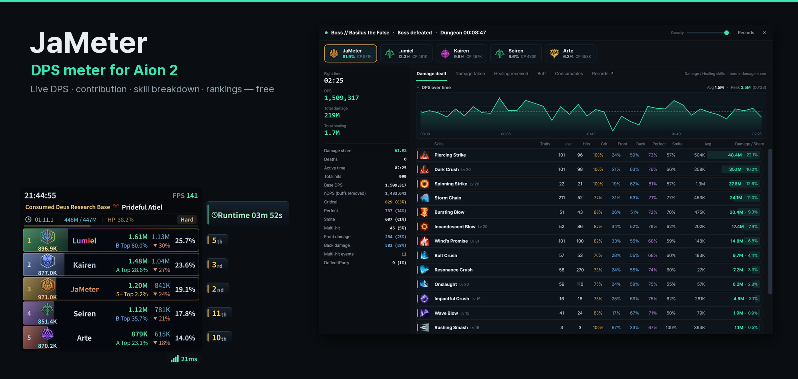
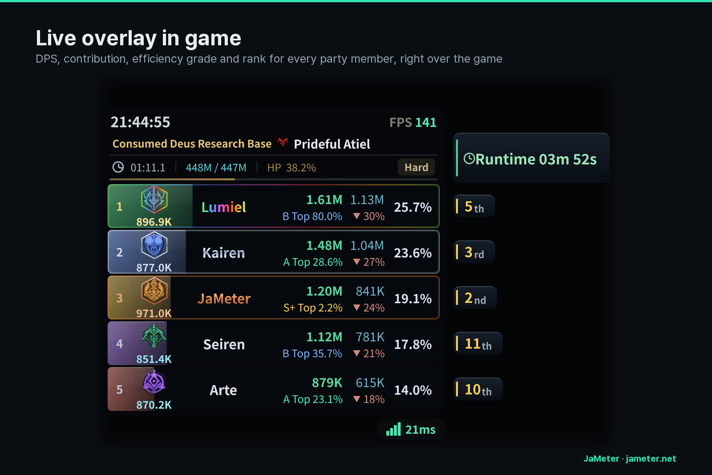
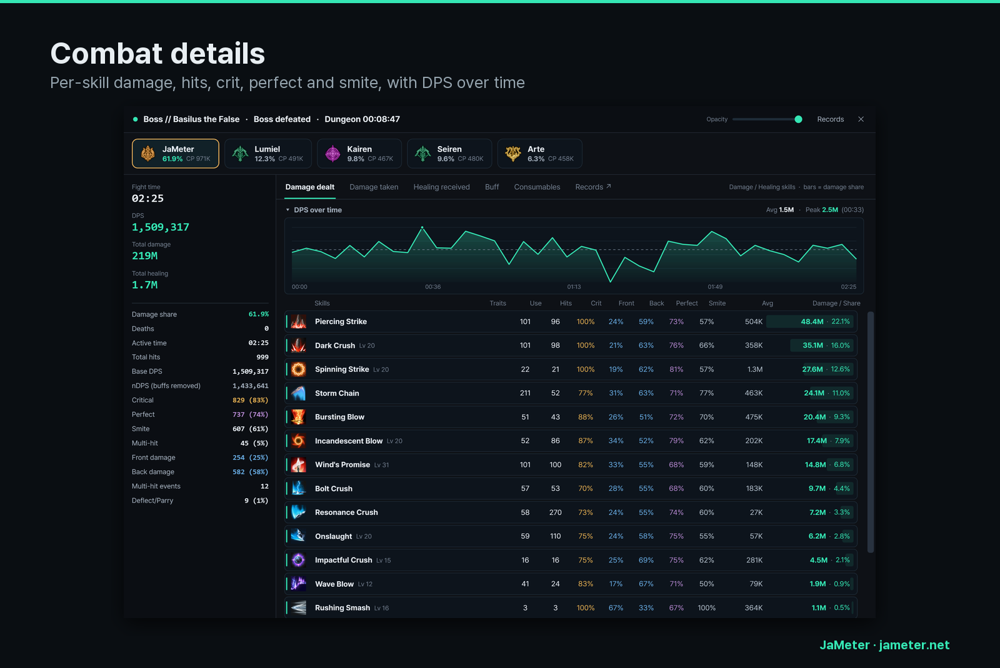
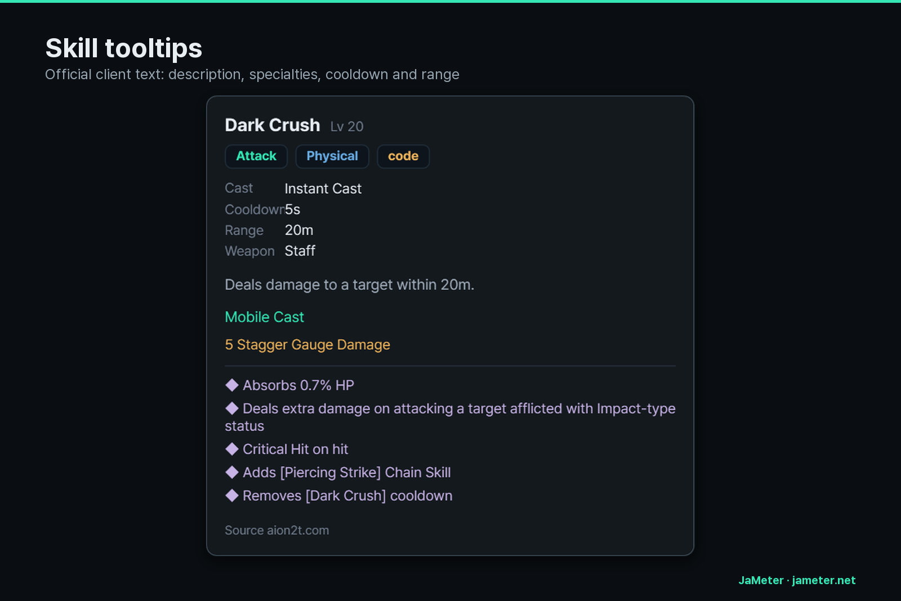
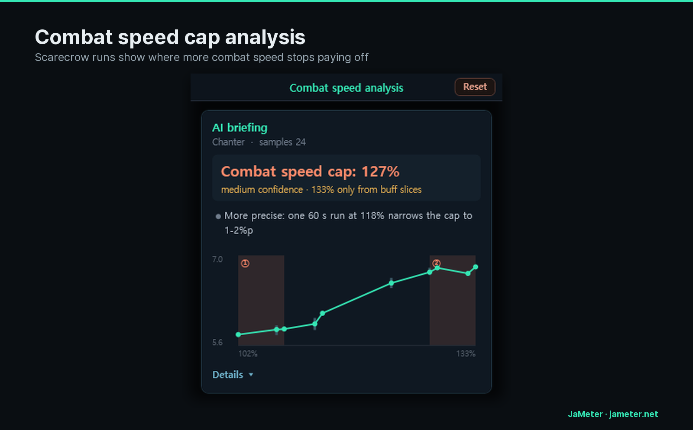
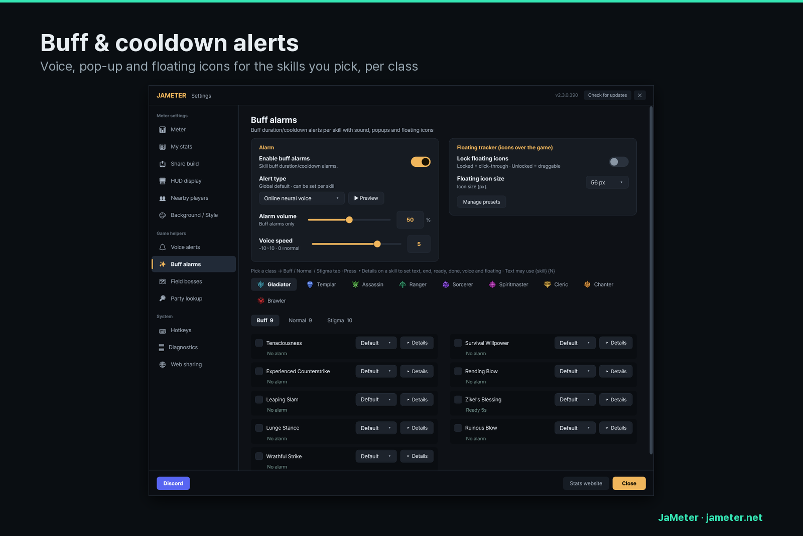
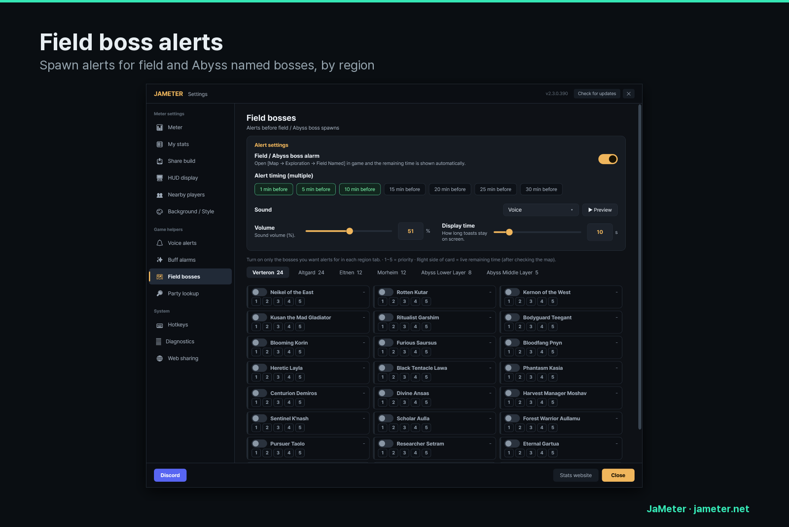
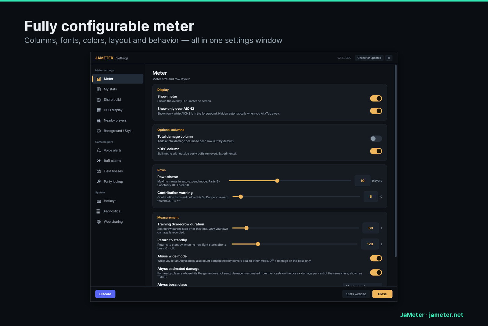
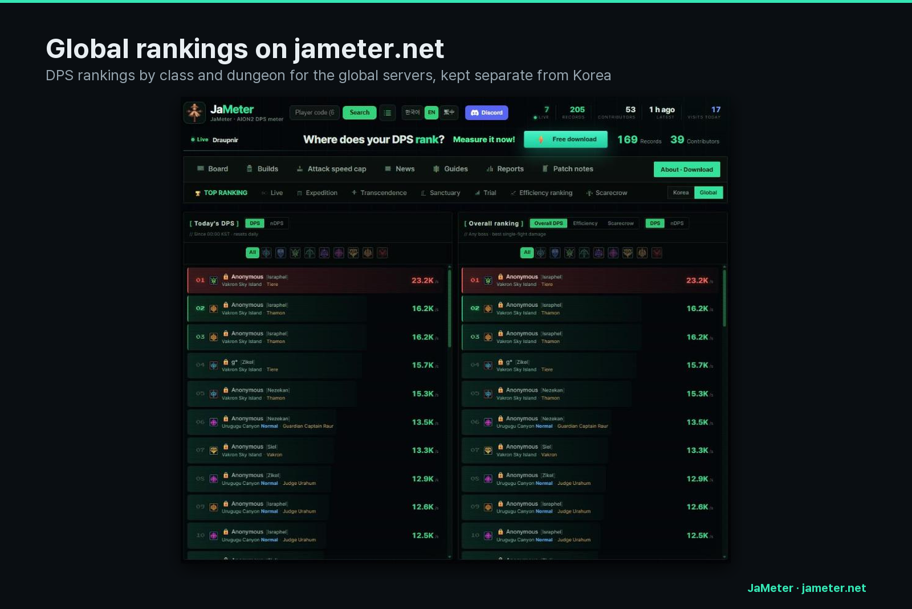

# JaMeter — DPS Meter for Aion 2

**JaMeter** is a free DPS meter for **Aion 2** (아이온2). It shows live DPS and party contribution over the game, breaks every fight down skill by skill, and adds you to anonymous crowd rankings on [jameter.net](https://jameter.net/en). It works on the **global servers** (NA West, NA East, Europe, Asia, Latin America) and on the Korean servers.

- **Download:** [Latest release](https://github.com/jeojabon/JaMeter/releases/latest) — `JaMeter.exe`, Windows 10/11, free, no installer
- **Website:** [jameter.net/en](https://jameter.net/en) · [Global DPS ranking](https://jameter.net/en/ranking)
- **Community:** [Discord](https://discord.gg/v6TAwBCkQZ)

## Features

### Live overlay
DPS, nDPS (outside party buffs removed), contribution, combat power and efficiency grade for every party member, plus boss HP, run timer and your rank after the fight.

### Combat details
Every skill broken down: uses, hits, crit, front/back, perfect, smite, average hit and share of damage, with a DPS-over-time graph. Damage taken, healing received, buffs and consumables have their own tabs.

### Skill tooltips
Hover a skill for its description, specialties, cast time, cooldown, range and weapon — official client text in English.

### Combat speed cap analysis
Measure a 60-second Training Scarecrow run at different combat speeds and JaMeter shows where more combat speed stops paying off for your character.

### Buff & cooldown alerts
Pick the skills you care about per class and get voice, pop-up or floating-icon alerts when a buff ends or a cooldown is ready.

### Field boss alerts
Spawn alerts for field and Abyss named bosses, by region, minutes ahead.

### Settings
Columns, fonts, colors, layout and behavior of the meter are all adjustable. The interface switches to English automatically on an English Windows (or set it in the settings).

### Rankings on jameter.net
With web sharing on, your boss fights join anonymous rankings by class and dungeon. Global-server records are ranked separately from Korea, which runs a different patch.

## Getting started
1. Install [Npcap](https://npcap.com/) once (JaMeter reads network packets through it).
2. Download `JaMeter.exe` from the [latest release](https://github.com/jeojabon/JaMeter/releases/latest) and run it. No installer; it updates itself.
3. Start a fight. Measuring begins automatically.
4. Optional: Settings → Web sharing → on, to join the rankings anonymously. It is off by default.

## Safety and privacy
- JaMeter reads the game's network packets passively through Npcap. It never reads or writes game memory, injects nothing and does not modify the client.
- No meter is approved by NCSOFT. Use it at your own discretion.
- Download JaMeter only from this repository's releases.
- The exe is not code-signed yet, so SmartScreen or antivirus may warn about an unknown publisher. On SmartScreen choose **More info → Run anyway**.
- Uploading stats is opt-in and off by default. Your character name stays hidden unless you choose to show it, and other players' names are never stored. You can delete your data from the settings at any time. See the [privacy policy](https://jameter.net/privacy).

---

Unofficial fan-made tool — not affiliated with, sponsored by, or endorsed by NCSOFT or Aion 2. Game names and images belong to their respective owners.

한국어 안내: [jameter.net](https://jameter.net)

Keywords: Aion 2 DPS meter, AION2 damage meter, Aion 2 DPS ranking, Aion 2 leaderboard, Aion 2 combat meter, DPS overlay, global servers, 아이온2 딜미터기, 자터기.
